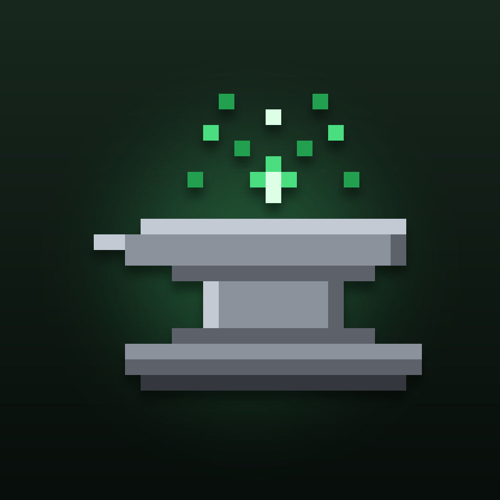

<p align="center"></p>

# Anvil — лаунчер Minecraft: Java Edition для iOS и iPadOS

**[⬇︎ Скачать последнюю сборку (Anvil.ipa)](https://github.com/RBXLU/AnvilLauncher/releases/download/latest/Anvil.ipa)**

Нативное приложение на SwiftUI, которое ставит и запускает Java Edition прямо на iPhone и iPad. Игра крутится на OpenJDK, собранной под iOS, поэтому без JIT не запустится.

## Что умеет

- **Версии.** Любая версия из манифеста Mojang, включая снапшоты и старьё. Библиотеки и ассеты качаются параллельно с проверкой SHA-1.
- **Загрузчики модов.** Fabric и Quilt ставятся сразу. Forge и NeoForge — своим официальным установщиком внутри приложения; после установки Anvil закрывается, его нужно открыть снова.
- **Modrinth.** Поиск модов, ресурспаков, шейдеров и модпаков с фильтром по версии игры и загрузчику. Обязательные зависимости подтягиваются сами. Импорт `.mrpack` из «Файлов».
- **Память.** Слайдер выделения ОЗУ, глобально и отдельно для каждой сборки. В entitlements запрошен `increased-memory-limit`.
- **Аккаунты.** Вход через Microsoft (OAuth → Xbox Live → XSTS → Minecraft Services, токены в Keychain) и офлайн-ники.
- **Управление:**
  - экранные кнопки и джойстик; раскладка редактируется прямо в игре (меню ⋯ → «Редактировать кнопки», долгое нажатие — назначение и размер);
  - камера пальцем, короткий тап — «использовать», удержание — «ломать»;
  - мышь с захватом курсора (pointer lock на iPad), аппаратная клавиатура, экранная клавиатура для чата;
  - геймпады Xbox, PlayStation, MFi; при подключении внешних устройств экранные кнопки прячутся.
- **JIT.** Проверка `CS_DEBUGGED`. Перед запуском лаунчер ждёт, пока JIT включат через StikDebug, SideStore или Xcode. На iOS 26 с TXM JVM запускается с зеркальным кодовым кэшем, а отладчик должен оставаться подключённым (скрипт Universal JIT в StikDebug).
- **Рендер.** MobileGlues (OpenGL 4.x → GLES → ANGLE → Metal) для 1.17+ и gl4es для 1.16.5 и старше; выбор «Авто» решает сам.

## Как это устроено

```
SwiftUI-лаунчер ──► GameLauncher (classpath, аргументы JVM/игры)
                         │
                         ▼
App/Native/jvm.c ──► dlopen(libjli) → JLI_Launch в потоке с 8 МБ стека
                         │
Java: org.lwjgl.glfw.GLFW (шим) ──JNI──► App/Native/glfw_bridge.m
   окно = CAMetalLayer, контекст = EGL (ANGLE)     ▲
   ввод = очередь событий ◄────────────────────────┘ GameViewController
                                                    (касания, мышь, клавиатура, геймпад)
```

Свой класс `GLFW` лежит в classpath раньше `lwjgl-glfw.jar` и перекрывает оригинал: игра думает, что работает с обычным GLFW, а на деле всё идёт через нативный мост приложения.

## Сборка

Нужен Mac с Xcode 16+, JDK 17+ и [XcodeGen](https://github.com/yonaskolb/XcodeGen).

```bash
git clone https://github.com/RBXLU/AnvilLauncher && cd AnvilLauncher
./scripts/fetch-deps.sh     # Java 8/17/21/25 для iOS, LWJGL, ANGLE, gl4es, MobileGlues, GLFW-шим
xcodegen generate
open AnvilLauncher.xcodeproj
```

Без Mac: GitHub Actions (`.github/workflows/build.yml`) собирает неподписанный `Anvil.ipa` на каждый пуш в `main` и выкладывает его в релиз [`latest`](https://github.com/RBXLU/AnvilLauncher/releases/tag/latest). Его можно поставить через SideStore, AltStore или TrollStore.

Иконку рисует `scripts/make-icon.py` (Pillow): `python3 scripts/make-icon.py App/Resources/Assets.xcassets/AppIcon.appiconset/AppIcon.png`.

## Ограничения

- JIT обязателен. Без него HotSpot не может сгенерировать даже интерпретатор.
- Когда игра закрывается, закрывается и приложение: JVM запускается в том же процессе, и вернуться из неё нельзя.
- Рантаймы Java, LWJGL и рендереры под iOS — готовые сборки проекта [Amethyst](https://github.com/AngelAuraMC/Amethyst-iOS) (GPL-3.0). Поэтому и Anvil распространяется под GPL-3.0.
- Minecraft — товарный знак Mojang/Microsoft. Anvil с ними не связан и игру не распространяет: файлы качаются с серверов Mojang, а для игры нужен купленный аккаунт.
